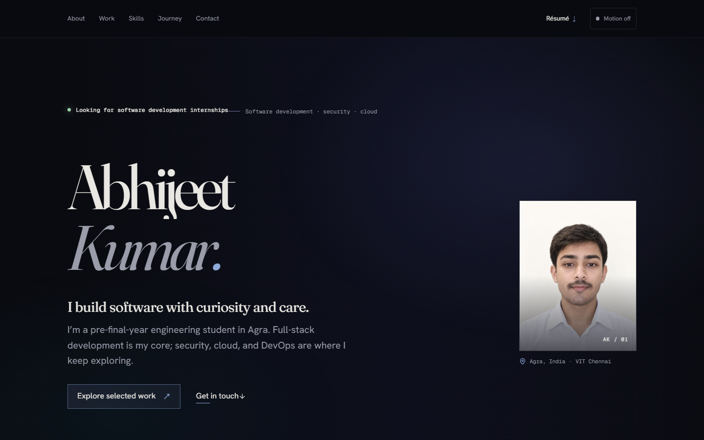

# Abhijeet Kumar — Portfolio

A personal portfolio for selected software projects, internship experience, and current areas of learning.



## Built with

Next.js App Router, React, TypeScript, SCSS Modules, GSAP, and Three.js. The hero remains readable before the visual effect loads and when motion is disabled.

## Run locally

```bash
npm install
npm run dev
```

Open `http://localhost:3000`.

## Update the content

| File | Content |
| --- | --- |
| `content/site.ts` | Profile details, links, and dated proof values |
| `content/projects.ts` | Project summaries, links, case studies, and visibility |
| `content/experience.ts` | Education and internship timeline |
| `content/skills.ts` | Skill tracks and experience levels |
| `content/offduty.ts` | Personal interests |

Set a project's visibility to `featured`, `listed`, or `hidden`. Hidden projects are excluded from the site and generated text feeds.

### Photos and résumé

Replace the image files under `public/images/` while keeping their filenames to update the portraits without changing code. Put the résumé at `public/resume/Abhijeet_Kumar_Resume_Final_v8.pdf`; the header links to that file.

## Checks

```bash
npm run lint
npm run typecheck
npm run build
npm run test:e2e
npm run analyze
npm run audit
```

## Deploy to Vercel

Import this GitHub repository into Vercel and keep the detected Next.js settings. After the first deployment, set `NEXT_PUBLIC_SITE_URL` to the assigned production URL and redeploy; this enables canonical URLs and the production sitemap entries. No custom domain is currently configured.

## Notes

The résumé and project facts are maintained in `content/`. Decisions and details that still need confirmation are in `TODO.md` and `ASSUMPTIONS.md`. Font files and their open licenses are in `public/fonts/`.
